<!-- ═══════════════════════════  HERO  ═══════════════════════════ -->

&nbsp;
&nbsp;
&nbsp;
&nbsp;
&nbsp;

<!-- ═══════════════════════════  ABOUT  ═══════════════════════════ -->
<table>
<tr>
<td width="62%" valign="top">

</td>
<td width="38%" valign="top">

### ⚡ Right now

- 💼 &nbsp;**SDE-1** at **SwiffyLabs**
- 🧱 &nbsp;Building a **Portfolio Generator**
- 🤖 &nbsp;Shipping faster with **agentic coding**
- 📱 &nbsp;Learning **React Native** & **Java**

### 🤝 Open to

UI/UX work · open source · frontend collabs

### 💬 Ask me about

React · frontend architecture · performance

</td>
</tr>
</table>

<!-- ═══════════════════════════  STACK  ═══════════════════════════ -->
<h2 align="center">Tech I build with</h2>

<!-- ═══════════════════════════  PROJECTS  ═══════════════════════════ -->
<h2 align="center">What I'm building</h2>

<table>
<tr>
<td></td>
<td></td>
</tr>
</table>

<!-- ═══════════════════════════  CONTRIBUTIONS  ═══════════════════════════ -->
<h2 align="center">Contribution history</h2>

<!-- ═══════════════════════════  FOOTER  ═══════════════════════════ -->

